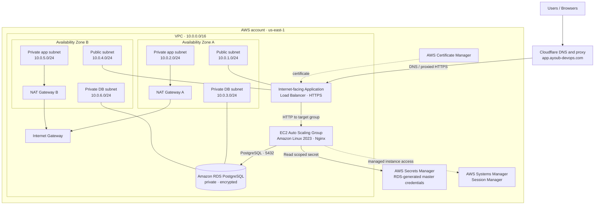
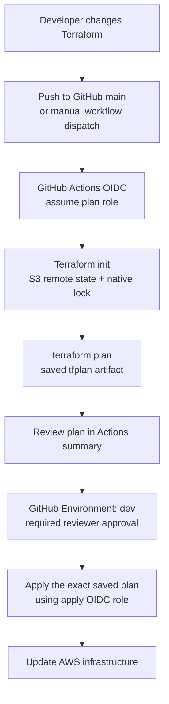

# Architecture and traffic flows

This document describes the architecture implemented by the Terraform configuration. It distinguishes the resources that are deployed today from production improvements that remain future work.

## High-level architecture

> **Database availability clarification:** The RDS subnet group contains private subnets in both AZs, but the current RDS resource explicitly sets `multi_az = false`. The diagram shows the subnet group boundary, not a Multi-AZ database deployment or standby.

## Traffic flow

### Inbound application traffic

1. The client resolves the application hostname through Cloudflare.
2. Cloudflare's proxied DNS record points to the ALB DNS name.
3. The ALB security group accepts inbound HTTP/HTTPS.
4. When HTTPS is enabled, the HTTP listener redirects requests to HTTPS. ACM provides the listener certificate.
5. The ALB target group forwards HTTP traffic to the EC2 instances on the application port.
6. The application security group allows that port only from the ALB security group.

### Application egress

Each private application subnet has its own route table and same-AZ NAT Gateway. Outbound requests from an application instance use its AZ-local NAT Gateway and then the Internet Gateway. This avoids routing normal application egress through a NAT Gateway in the other AZ.

### Database access

The RDS instance is not publicly accessible. Its security group allows TCP/5432 only from the application security group. The PostgreSQL parameter group sets `rds.force_ssl = 1`. RDS manages the generated master password in Secrets Manager; the EC2 role receives a policy scoped to the RDS secret ARN.

The database subnets are associated with private route tables and do not have a default route to the Internet Gateway or NAT Gateways.

## Infrastructure delivery flow

The workflow serializes runs with a Terraform concurrency group and does not cancel an active apply. The bootstrap stack creates the S3 state bucket and GitHub OIDC roles separately from the application infrastructure.

## Current capacity and configuration

| Area | Current configuration |
|---|---|
| Region | `us-east-1` |
| VPC | `10.0.0.0/16` |
| Availability Zones | Two |
| Public subnets | Two |
| Private application subnets | Two |
| Private database subnets | Two |
| NAT | Two, one per AZ |
| EC2 | Amazon Linux 2023, `t3.micro` |
| Auto Scaling | Min 2 · Desired 2 · Max 4 |
| Load balancer | Internet-facing ALB |
| TLS | ACM certificate, DNS validation through Cloudflare |
| Database | PostgreSQL 17, `db.t4g.micro`, 20 GiB gp3 with 50 GiB autoscaling ceiling |
| RDS Multi-AZ | Disabled |
| Automated backup retention | 0 days by default |
| Database deletion protection | Enabled by default |
| Instance access | Systems Manager; no SSH ingress rule |

## Important production gaps

- Enable RDS Multi-AZ where the availability objective requires it.
- Configure non-zero automated backup retention and regularly test point-in-time recovery.
- Complete least-privilege CI permissions for RDS and Secrets Manager operations; verify Cloudflare token scopes.
- Replace the demonstration Nginx user-data page with a versioned application release and rollback mechanism.
- Add application-level telemetry, alarms, dashboards, and notification routing.
- Consider WAF/rate limiting and document the intended Cloudflare-to-ALB trust boundary.
